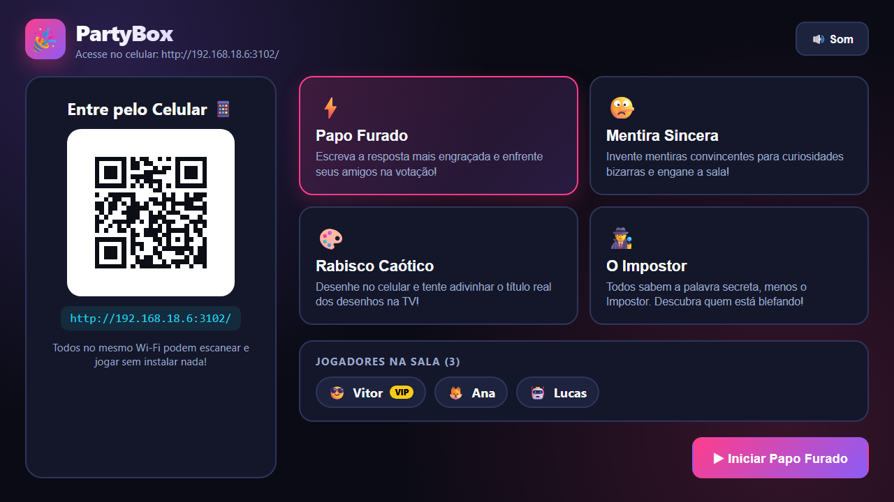

# 🎉 PartyBox

A lightweight, **Rust-powered** LAN party game pack inspired by Jackbox (in **Brazilian Portuguese / PT-BR**). Run it on your PC or mini-server, open the TV screen on your living room TV, and let friends scan the QR code to play directly from their phones—no app install required!



## 🕹️ Included Games (4-in-1 Lobby)

1. **⚡ Papo Furado** *(Quiplash-style)* — Hilarious fill-in-the-blank prompts, head-to-head voting on the TV, and 2x points in the final round.
2. **🤥 Mentira Sincera** *(Fibbage-style)* — Weird real facts with a blank; invent convincing lies (automatically normalizes casing and blocks accidentally typing the truth) and earn points for fooling friends or spotting the real answer.
3. **🎨 Rabisco Caótico** *(Drawful-style)* — Multi-color touch drawing pad right in the phone browser, full-screen gallery reveal on the TV, fake titles, and voting.
4. **🕵️ O Impostor** *(Undercover / Spyfall-style)* — Secret word on everyone's phone (with a tap-to-hide privacy toggle) except the Impostor, followed by live discussion, voting, and a last-chance word guess if caught.

## ✨ Highlights

- **Single lightweight Rust binary** (`axum` + WebSockets + SVG QR code generation, ~7 MB RAM).
- **Zero-install phone controllers** — iPhone & Android guests just scan the QR code on the TV.
- **Automatic reconnect** — Locking your phone mid-round won't lose your seat or score.
- **Synthesized Web Audio SFX** on the TV screen (zero audio assets required).

## 🚀 Quick Start

```bash
cargo run --release
```

1. Open the **TV Screen** on your PC or living room TV: `http://localhost:3102/tv`
2. Have friends on the same Wi-Fi scan the **QR Code** (or open `http://<your-lan-ip>:3102/`).
3. Pick any of the 4 games and hit **Iniciar**!

*(Configure the port with the `PORT` environment variable—defaults to `3102`.)*

## License

MIT
